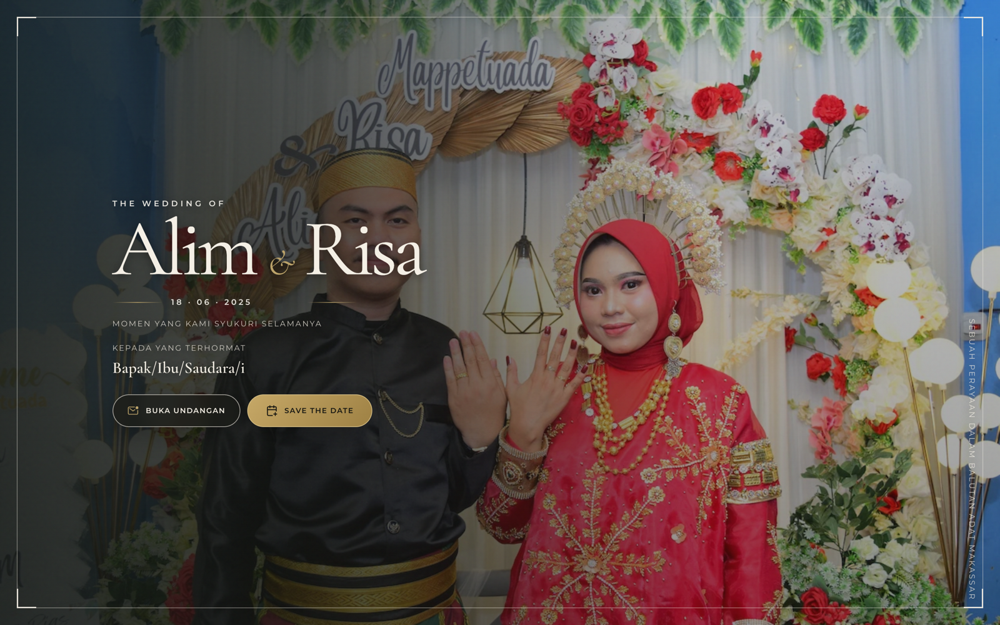
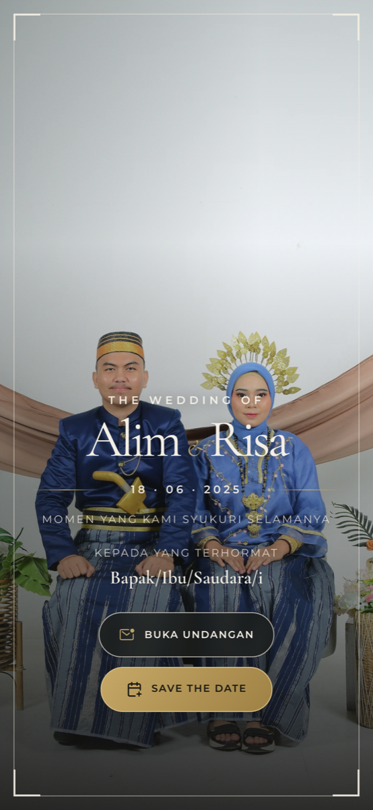
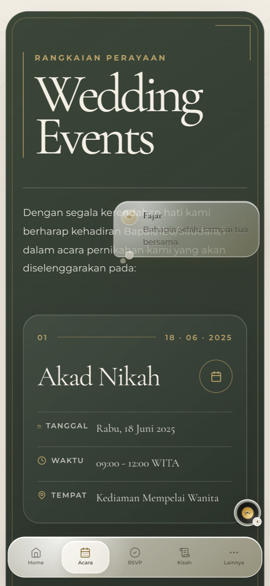
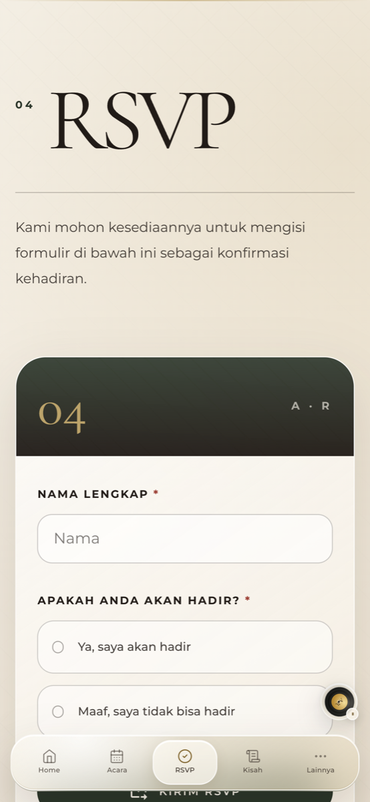
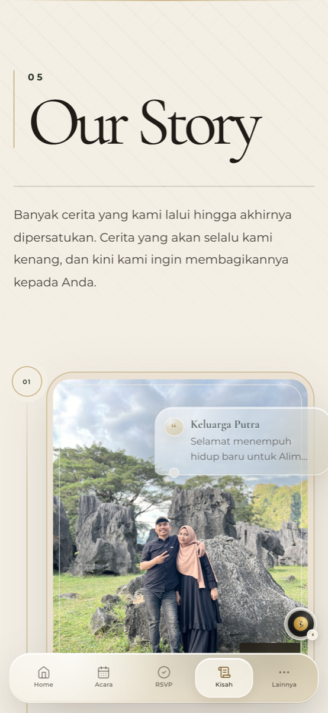
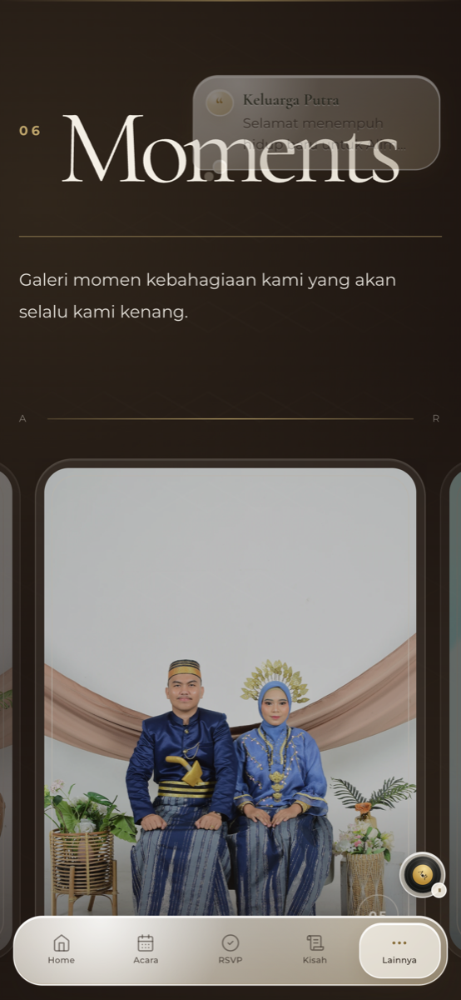
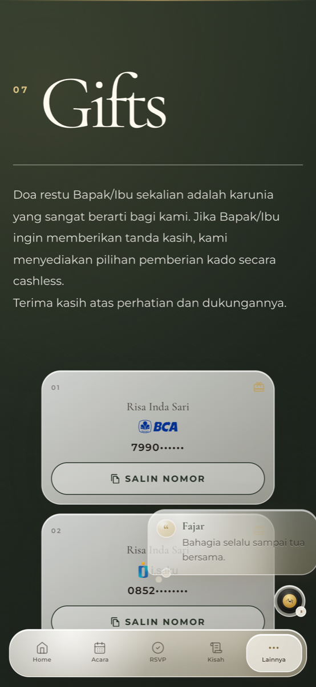

<h1 align="center">💌 Undangan Pernikahan Digital + RSVP</h1>

  Website undangan pernikahan digital <b>Alim &amp; Risa</b> dengan nuansa adat Makassar: 
  konfirmasi kehadiran (RSVP), buku tamu dan ucapan <i>real-time</i>, galeri, kisah, dan amplop digital.

  
  
  
  
  
  
  
  

> 🔒 Source code bersifat **private**. Repo ini adalah etalase project: deskripsi, fitur, dan tangkapan layar.

## Fitur Utama

- **Halaman sampul** dengan nama tamu dan tombol *Buka Undangan*, plus **Save the Date** (file kalender `.ics`).
- **Rangkaian acara**: akad dan resepsi, lengkap dengan tanggal, waktu, lokasi, peta, dan hitung mundur.
- **RSVP**: tamu mengonfirmasi kehadiran langsung dari undangan.
- **Buku tamu & ucapan real-time**: ucapan baru langsung muncul melayang di layar semua tamu (Socket.IO).
- **Kisah (Our Story)** dan **galeri momen** dengan animasi halus (Framer Motion).
- **Amplop digital**: daftar rekening dan e-wallet dengan tombol salin nomor.
- **Musik latar** dan **navigasi bawah** ala aplikasi, dirancang *mobile-first*.

## Tangkapan Layar

| Sampul | Acara | RSVP |
|---|---|---|
|  |  |  |

| Our Story | Galeri | Amplop Digital |
|---|---|---|
|  |  |  |

Ditampilkan atas izin. Nomor rekening dan nomor telepon pada tangkapan layar disamarkan.

## Teknologi

| Bagian | Teknologi |
|---|---|
| Frontend | React 18, TypeScript, Vite, Tailwind CSS, Framer Motion, Lucide |
| Backend | Express, TypeScript, MongoDB (Mongoose) |
| Real-time | Socket.IO |

---

Dibuat oleh <a href="https://github.com/kmpery-id">Km Pery Permana</a> · Makassar

